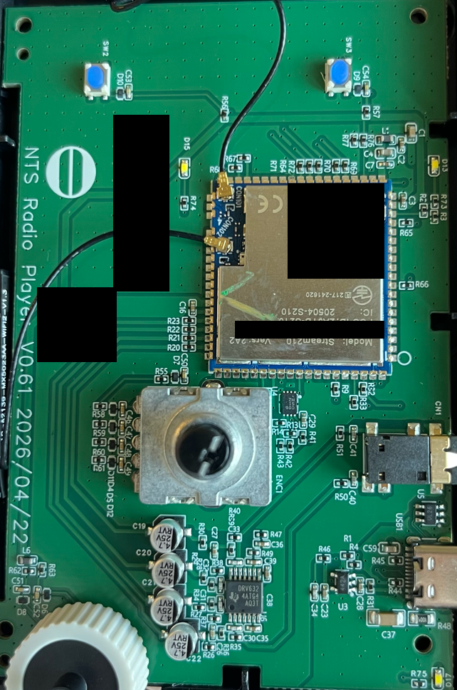
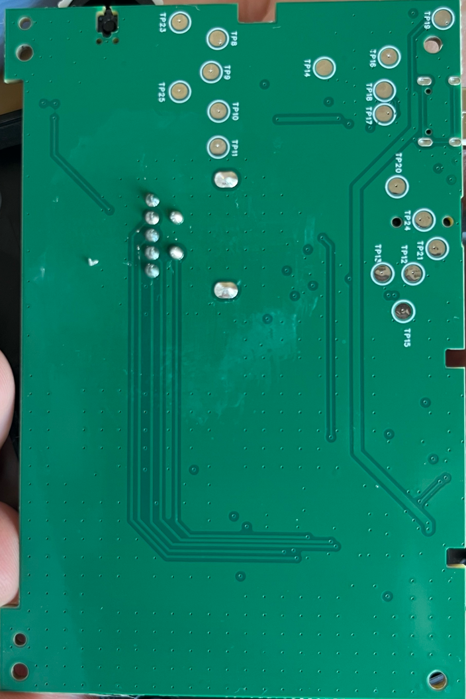

# Hardware

## Examined unit

These observations come from the owner's teardown photographs, not a schematic or electrical measurement.

| Marking/component | Observation |
|---|---|
| Carrier PCB | `NTS Radio Player_V0.61_2026/04/22` |
| Radio/processor module | `Model: Stream210`, `Vers: 2A2` |
| Product-level regulatory IDs | FCC `2AJYB-S210`; IC `20504-S210` |
| Analogue IC marking | `DRV632`, with Texas Instruments logo |
| Connectors | USB-C `USB1`; 3.5 mm jack `CN1` |
| Controls | Rotary component `ENC1`; switches `SW2` and `SW3` |
| Antennas | Two coaxial leads connected to the shielded module |

The PCB date is a **silkscreen marking**, not an independently verified manufacture date. `settings:/wac/hardwareRevision` reports `L2`; `settings:/system/boardName` reports `AtonemoStream210L2`.

### Component side



### Underside



These are cropped, resized derivatives of two owner-supplied photographs. Black rectangles remove unique module/board identifiers, QR codes and handwritten markings. The originals remain private. The published PNGs contain image data only, without EXIF, GPS or embedded thumbnails.

## Module specifications versus measured hardware

[StreamUnlimited's Stream210 page](https://www.streamunlimited.com/stream210/) specifies:

- Realtek RTL8730E; dual-core ARM Cortex-A32 at 1.3 GHz, with embedded MCU.
- 256 MB RAM and 256 MB NAND flash.
- Dual-band Wi-Fi 6 and Bluetooth capabilities.
- USB 2.0 host/device, UART, SPI, I²C and other multiplexed interfaces.
- A Yocto-based Linux BSP and development/update facilities.

These are **manufacturer specifications for the module family**, not measurements of this unit. The shield was not removed, the NAND was not dumped and usable RAM was not measured. Module capabilities do not establish which interfaces or services Atonemo enables in production. In particular, vendor references to secure boot, SSH and USB updates do not prove this radio's security configuration, accessible shell or recovery support.

The `DRV632` marking is visible. Its role in the exact signal path has not been traced; there is no measured DAC/output schematic here.

[Atonemo's product page](https://atonemo.com/products/nts) describes 3.5 mm AUX output and USB-C **power, 5 V / 1 A**. Do not transfer optical-output claims from the separate Atonemo Streamplayer product to this NTS unit.

## USB observations

The original macOS inspection found a device called “USB Keyboard” with VIA Labs VID/PID **`2109:d101`**, beneath a VIA USB 2 hub (`2109:2813`, with USB 3 companion `2109:0813`). It claimed a boot-keyboard interface but advertised Generic Desktop usage `0x09`, not keyboard usage `0x06`.

After the hub was removed, `system_profiler SPUSBHostDataType` and `ioreg -p IOUSB` showed **no radio USB device** in those snapshots.

Corrections and limits:

- `2109:d101` is **not an established USB identity for the Atonemo**.
- The earlier suggestion that it was a hidden hub firmware/KVM endpoint was an inference, not an identification.
- The snapshots and the manufacturer's “power” label do not prove disconnected USB data lines, absence of a boot mode, or impossibility of recovery.
- No successful radio USB enumeration or recovery session was recorded.

To inspect a future connection on macOS without changing device state:

```sh
system_profiler SPUSBHostDataType
ioreg -p IOUSB
```

Review the output before sharing: it can identify unrelated attached devices. On the research Mac, `SPUSBDataType` alone did not provide the useful tree.

## Test pads: no pinout yet

Readable labels include `TP8`–`TP21` and `TP23`–`TP25`. No photograph labels a pad TX, RX, GND, VCC, reset or boot mode. **The TP8–TP11 arrangement is not a proven UART header.**

A safe next investigation is ground/continuity mapping with power disconnected, then powered voltage and signal measurements by someone equipped to do them. Do not connect a 3.3 V or 5 V serial adapter based on appearance. Start receive-only with a voltage-matched input and shared ground after identifying the signals; leave adapter VCC and TX disconnected. Never use RS-232 voltage levels or bridge unknown pads.

See the [investigation plan](investigation.md) for the required evidence before publishing a pinout.
